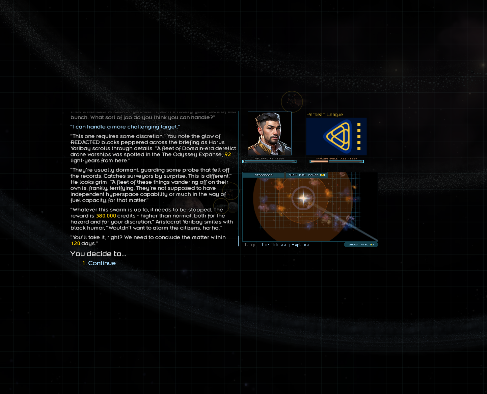

# Contact Derelict bounty in Orion Knot: live reproduction

The user reproduced the failure in the running game on October 29, 2026, after
reporting hundreds of attempts. The user subsequently closed the game. A later
read-only audit confirmed the accepted bounty in the saved campaign below.



## Observed offer

| Field | Screenshot evidence |
| --- | --- |
| Contact | Horus Yaribay, Persean League |
| Choice | More challenging target; native HIGH choice slot |
| Bounty | Domain-era Derelict drone fleet |
| Target | The Odyssey Expanse, inside Orion Knot |
| Distance | 92 light-years |
| Reward | 380,000 credits |
| Deadline | 120 days |

The screenshot establishes that the live contact-offer path selected an Orion
system. It does not establish acceptance, completion, or the numeric internal
difficulty. The exact debug-command invocation and attempt count were not
recorded. The earlier controlled native-picker seed results describe test
fixtures, not the probability of selecting Orion in this campaign.

## Native path identification

- Installed `starsector-core/data/campaign/rules.csv:25819` contains rule
  `CBDerelict`, trigger `CBDerelictOfferDesc`, matching this fleet briefing.
- The native `mcb_high` choice routes through `mcbHighSel` and `MCBShowBounty`
  around rules lines 25761-25774.
- Native `BaseCustomBounty` selects `creatorHigh`/`dataHigh` and dispatches the
  creator's `OfferDesc` trigger. Forced debug rolls can give all choice slots the
  same numeric difficulty, so the HIGH slot is not proof of a particular level.
- `CBDerelict` favors black holes, nebulae and fringe systems. Its system search
  does not honor system-level `NOT_RANDOM_MISSION_TARGET`.

## Fix and remaining verification

The user explicitly replaced the earlier creator-specific fix with the native
`Tags.THEME_HIDDEN` approach on October 29, 2026. Normal native bounty generation
is restored: the plugin no longer replaces the Derelict creator or mutates its
registry. The retired `OrionKnotDerelictBounty` class remains as an inactive
compatibility shell so development saves that serialized it can still load.

All six owned Orion systems receive `THEME_HIDDEN` during generation. Every load
also calls `OdysseyExpanseSystem.reconcileRandomMissionTags()`, which adds only
that tag to existing owned systems, including legacy ownership evidence. It does
not rebuild systems, alter routes, or touch accepted missions and contact
cooldowns. Same-ID foreign claims remain untouched. No CORE tags are introduced.

The existing `STAR_HIDDEN_ON_MAP`, navigation and jump-point settings remain
unchanged. `THEME_HIDDEN` is the native mission-search exclusion; its name does
not itself require adding the separate star-map hiding tag. The exclusion also
applies to other native mission/event generators that honor `THEME_HIDDEN`.

The live-tested local development artifact is `jars/ChiefNavigator.next2.jar`, SHA256
`170bd3bd305af68ee37c00a3a3302f13211d13a37244e83b775cfcc4823ff583`.
The earlier stash `85f0e58075f9f39e876bcf48d90e2517a9a0770f` remains historical
backup of the superseded creator-specific approach.

Start the rebuilt game, load the campaign, and run:

```text
RefreshContactBounties status
```

This read-only check works without an open contact or an available bounty. The
expected output names the normal `CBDerelict` generator and includes
`Orion Knot systems tagged THEME_HIDDEN: 6/6 (native mission-search exclusion).`
The diagnostic checks saved-world tag coverage without calling a creator
predicate. Missing owned systems or a missing registered creator are explicit.

For a new offer, open an available native military contact's jobs and run
`RefreshContactBounties derelict 10`. The three newly generated choices should
target eligible systems outside Orion. An accepted pre-fix bounty retains its
original location and can prevent the same contact from offering another bounty.

Build and installed-jar native picker, diagnostic, type, refresh, world
initialization, campaign lifecycle and jump-point lifecycle checks pass. The
unchanged native picker selected Orion 3,602/4,096 times before tagging and
0/4,096 after tagging in controlled current/legacy preferred/fallback fixtures.
The generation helper and repeated existing-world reconciliation were exercised
directly; native registry entries and unrelated state were preserved. These
fixture frequencies are not campaign spawn probabilities. After testing the
hidden-tag build, the user reported "Seems to work" and requested a push. This is
live confirmation of the reported bounty behavior; detailed load/save/reload and
map/travel coverage were not separately reported.

Console-command cleanup remains deferred: later move the reproduction commands
into an optional debug package or disable their registration by default. Keep
them available for the current bounty investigation.

## Saved-campaign diagnosis of missing offers

The user clarified that refreshing without a forced Derelict type also leaves
the contact saying no missions are available. The read-only audit found the
following in `../../saves/save_A_8666867206689798321/campaign.xml`:

- Horus Yaribay's person/hub are identified at lines 71644-71689. His native
  `mcb` timeout has 57.706886 days remaining, and the recently accepted timeout
  records 30 days.
- His `$mcb_ref` points to an accepted `MilitaryCustomBounty` in stage `BOUNTY`
  at lines 71757-71759.
- That mission uses `CBDerelict`, rewards 380,000 credits, has difficulty 10 and
  references The Odyssey Expanse at lines 106165-106173; the system definition
  and stable ID are at lines 71947 and 92222.

The native `BaseCustomBounty.create` refuses a new mission when that person's
mission reference is already occupied. `BaseMissionHub.accept` removes the
accepted offer and adds cooldowns; the installed `mcb` specification uses a
30-60-day timeout. This explains why the saved Horus contact has no unaccepted
bounty to reroll. Preserve the accepted mission and its reference.

The retained log from the earlier creator-specific build supports this diagnosis. Its refresh attempts
at lines 121943-122022 either lack the required open contact context or return
`This NPC has no unaccepted custom bounty offer to refresh` before reaching
generation. None of those attempts exercises fixed target generation. The log
contains `RefreshContactBounties derelict 10` and `RefreshContactBounties 10`;
the latter is not the no-argument syntax, and its first argument would be treated
as a type if an eligible offer existed. The user's report of plain refresh is
retained; those exact invocations were not captured in this session's log.

For live verification, use another contact with an available unaccepted native
military bounty, or a save from before accepting Horus's bounty. The matching
reproduction command is `RefreshContactBounties derelict 10`; unrestricted
generation is `RefreshContactBounties` with no arguments. Do not clear the
accepted bounty merely to make this command run. No runtime source, save or jar
was changed during that diagnosis. The subsequent user-authorized hidden-tag
implementation and subsequent user-reported live success are recorded above.

## Tag advice cross-check

The user's Discord reference recommends `Tags.THEME_CORE` for inhabited systems
and notes that only some bounty types exclude `THEME_UNSAFE`. The installed
native `CBDerelict` confirms that it excludes `THEME_CORE` and ignores
`THEME_UNSAFE`. The shared mission search implicitly excludes `THEME_HIDDEN`.

Adding CORE would block this Derelict path but also reclassify Orion for other
native generation. The user explicitly selected THEME_HIDDEN to avoid that
classification change. Further native inspection corrected the earlier visibility
concern: STAR_HIDDEN_ON_MAP is a separate tag, and no direct map/travel restriction
from THEME_HIDDEN alone was found. The implementation above supersedes the
earlier scoped Derelict predicate and the historical instruction to remove
THEME_HIDDEN from Orion systems.
